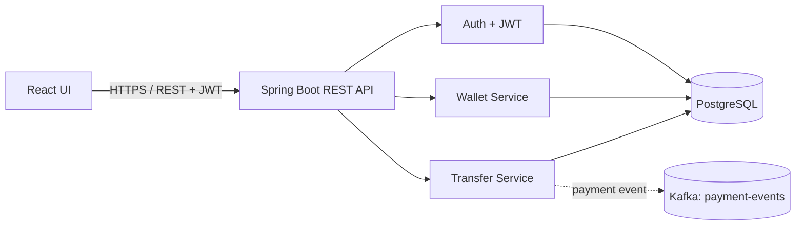

# Architecture

## Transfer sequence
1. Authenticated user submits a transfer with an `Idempotency-Key`.
2. API validates the payload and locks the two wallet rows in stable UUID order.
3. API verifies ownership, currency compatibility, and sufficient funds.
4. Source wallet is debited, destination wallet is credited, and a transfer record is persisted in one database transaction.
5. A Kafka event is attempted for downstream consumers.

## Production improvement
The current publisher is not a transactional outbox. A crash after database commit but before event delivery can lose the event. For a stronger design, persist an outbox record in the same database transaction and have a separate publisher deliver outbox rows to Kafka with retries.
